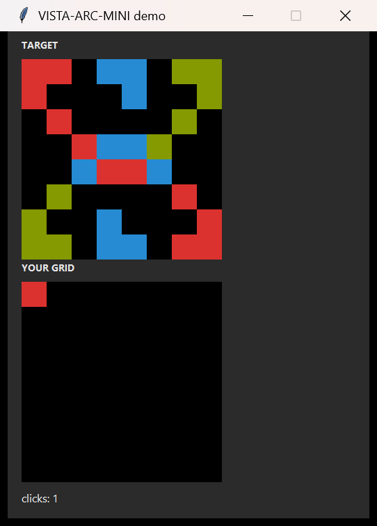

# dsh-vista-visual-harness

A [DeepSeek Harness](https://github.com/deepseek-ai) host plugin that implements the
**VISTA visual harness** from
[*VISTA: A Visual Harness for Reasoning in an Interactive World*](https://arxiv.org/abs/2610.02200)
(Han, Hu, Qiu, Wu, He — MIT).

It gives an agent **long-horizon vision** for interactive desktop worlds: every
observation is archived losslessly, the model can re-attend to any earlier frame or
zoom into any region, exact pixel colours can be measured, and each turn executes
exactly one input action whose result is observed before the next decision.



## The idea in one paragraph

The paper's ablation (same backbone, GPT-5.6 Sol) shows the harness is what unlocks
the model: text-grid baseline **13.33** RHAE → PNG observations **47.32** → continuous
conversation/compaction **65.82** → `GUIDE.md`/`WORKING.md` notes **70.05** → lossless
visual memory + model-directed `inspect` **94.10** → `read_pixels` exact readout
**99.00**. With Claude Opus 5.0 the full harness scores **100.00** on all 25 public
ARC-AGI-3 games using 57.4% fewer actions than first-time humans. This plugin ships
that harness as native DSH tools so the model never has to serialize the world into
text, and never loses evidence it already saw.

## Tools

| Tool | What it does | Returns |
|---|---|---|
| `vista_start` | Start a run on a window / the screen / a screen region / a static image; archive the first observation | image + run path |
| `vista_observe` | Archive another turn without acting (a burst can catch animation frames) | image |
| `vista_inspect` | Retrieve any archived turn/frame, crop any region, enlarge it; several views can be stacked into one labeled montage | image |
| `vista_read_pixels` | Split a region into `rows × cols` cells; report palette, per-cell index, exact RGB and mixed cells | JSON |
| `vista_play` | Execute **exactly one** action (click / click in frame coordinates / key chord / type / move / scroll / drag), then archive the resulting turn | image |
| `vista_notes` | Read/write `GUIDE.md` and `WORKING.md`, save a compaction checkpoint, print the handoff bundle | text |
| `vista_history` | Action events, attempt summaries split at resets, or the archived frame index | JSON |
| `vista_status` | Current run summary | JSON |

`GUIDE.md` holds durable, revisable understanding; `WORKING.md` holds the current
state, the prediction being tested, and the compaction handoff. Only the final frame
of a turn is shown automatically; everything else stays in the lossless archive and
is pulled back with `vista_inspect` — the paper's *re-attention* (across time and
space).

## Requirements

- **Windows 10/11** — capture uses Win32 `PrintWindow`, input uses `SendInput`.
- **DeepSeek Harness** with a profile (tested on DSH `0.2.1-rc.2`, desktop profile).
- **Python 3.10+ with Pillow** — the plugin auto-discovers the Python bundled in
  `%USERPROFILE%\.dsh\dsh-runtimes\*\dependencies\python`, otherwise `python` on
  `PATH`. Override with `$env:VISTA_PYTHON`.
- A model route that declares image input (the plugin returns images as tool results).

## Install

The plugin is a profile-local DSH bundle: it is installed by linking the checkout
into a profile and selecting the bundle. The `install.cmd` wrapper does exactly that
(and backs up the profile configuration first).

```powershell
git clone https://github.com/gotoanywhere2021/dsh-vista-visual-harness.git
cd dsh-vista-visual-harness
.\install.cmd
```

Verify from any DSH session:

> call `vista_status` — it should answer with a run summary (or "no run" before the
> first `vista_start`).

Uninstall:

```powershell
.\install.cmd -Uninstall
```

The installer writes only to the DSH profile: a `link:` dependency, the bundle
selection in `dsh.profile.bundles`, and a backup directory next to this README.
The running Harness hot-recomposes the profile, so the tools appear on the next model
request. **Changed plugin JavaScript needs a host restart** (DSH HMR reloads profile
configuration, not plugin modules by default).

## Use

Simply ask the agent to look at / operate a window; the tools carry their own usage
rules. A typical loop:

```text
vista_start(window="Some game or tool")
read the returned image, reason, maybe vista_inspect / vista_read_pixels
state a prediction
vista_play(click_frame=..., ...)      # exactly one action
read the returned image, state what changed
update vista_notes
```

The paper's Appendix A.5 shows the short prompt templates this harness was evaluated
with, and Appendix A.4 documents the tool contract in pseudocode. You can also simply
ask the agent in natural language, e.g.:

> "Watch Notepad, type `hello`, and show me the result."
>
> "Open the PDF proof window, archive every page, and flag the pages where the caption
> sits on a different page from its figure."

## Architecture

```text
index.js            Host plugin: 8 tool definitions, argument mapping, image attachments
cordis.patch.yml    Bundle patch: inserts the plugin row
engine/             Python engine: Win32 capture, SendInput, lossless archive,
                    crop/zoom/montage, exact pixel readout, notes, history
locale/·icon.svg    Plugin-manager display metadata
install.ps1/.cmd    Profile installation (link + bundle selection, with backups)
tests/smoke.mjs     Offline test: mocked tool context + real engine on a fixture image
```

The host plugin is a thin facade: it spawns `engine/vista.py`, parses the JSON tool
result, turns PNGs into `attachments.saveImage` image blocks (so images arrive
directly in the tool result), and returns compact text. The engine runs the same code
as the companion `vista-visual-harness` skill; runs live in
`%USERPROFILE%\.dsh\vista\runs\<id>\` (`frames/` originals + sha256, `obs/` per-turn
observation, `views/`, `index.jsonl`, `history.jsonl`, `notes/`).

Optional configuration (plugin row `config` or environment):

| Setting | Default | Meaning |
|---|---|---|
| `pythonPath` (config) / `VISTA_PYTHON` | auto-detect | Python interpreter with Pillow |
| `runsRoot` (config) / `VISTA_HOME` | `%USERPROFILE%\.dsh\vista` | Where run archives live |

## Development

```powershell
node tests/smoke.mjs
```

The smoke test imports the real plugin, feeds it a mocked tools/attachments context,
and drives the real Python engine against `tests/fixtures/target-pattern.png`:
static ingest, exact `read_pixels`, `inspect` montage, notes, history, status, and
the refusal of `vista_play` on static runs. CI runs the same test on Windows.

For a live test: `install.cmd` from a checkout, start any window (e.g. Notepad), then
use `vista_start` → `vista_observe` → `vista_play`.

## Security and safety

- The plugin injects **real mouse and keyboard input** into the Windows desktop.
  Use it only on windows you are allowed to automate; the agent is instructed to
  avoid irreversible controls and to verify each action from the returned image.
- No network access: capture, input and the archive are local. The engine spawns a
  local Python process; it does not download anything.
- Runs can contain screenshots of whatever was on screen; they are stored under the
  local VISTA home. Delete the run directory to remove them.
- The plugin runs in the DSH host process (unlike workspace tool sandboxes). A broken
  plugin can affect the Harness; keep the profile backup produced by the installer.

## Compatibility and limits

- Windows only. No macOS/Linux backend.
- Host plugin API is young; tested against DSH `0.2.1-rc.2`. Re-test after DSH updates.
- The harness amplifies existing model capability rather than adding reasoning; a
  weak backbone stays weak.
- Screen colour readout is exact for the rendered pixels, not for print/ICC colour.
- Public benchmark scores may reflect training-data overlap; treat them as harness
  evidence, not as proof of novel-world generalization.

## License and citation

MIT (see `LICENSE`). If you use the harness design, please cite:

```bibtex
@misc{han2026vista,
  title  = {VISTA: A Visual Harness for Reasoning in an Interactive World},
  author = {Han, Qiushi and Hu, Keya and Qiu, Linlu and Wu, Cathy and He, Kaiming},
  year   = {2026},
  eprint = {2610.02200},
  archivePrefix = {arXiv}
}
```

---

## 中文简介

这是把 VISTA 论文的视觉 harness 做成 DeepSeek Harness 原生命令的插件：`vista_start`
观察窗口/屏幕/图片，`vista_inspect` 回看任意历史帧并放大，`vista_read_pixels`
精确取色，`vista_play` 一次只做一个动作并自动截取结果，`vista_notes` 维护
GUIDE/WORKING 笔记与压缩交接。图像直接作为工具结果返回。

安装：`git clone` 后运行 `install.cmd`（写入当前 DSH profile，带备份）；卸载
`install.cmd -Uninstall`。仅支持 Windows；需要带 Pillow 的 Python（DSH 自带即可）。
已知限制和论文数据见上文与仓库文档。
